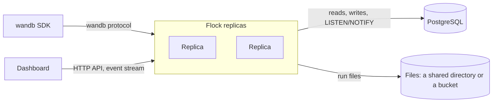

# How it works

Flock's design follows from one requirement: dashboards must get curves and filtered run tables back in a few tens of milliseconds, even across 10,000 runs with 1,500 columns each. This page explains the choices that make that possible, and what they cost.

## Stateless replicas, with PostgreSQL as the only state

Every request reads what it needs from PostgreSQL, and every write is committed there before Flock acknowledges it. A Flock process holds nothing that another one needs, so any number of replicas can serve one database, behind any load balancer, without sticky sessions. Starting one takes a second or less, whatever the amount of data, because nothing is loaded.

What a replica keeps in memory is only ever derived:
- **Its own dashboards' event streams.** They're fed by PostgreSQL notifications, so they see writes that land on any replica. See [Live updates](#live-updates).
- **A short-lived cache of credentials and roles.** Any change to accounts empties it on every replica. See [Authentication cost](#authentication-cost).

Background work, such as compacting curves, purging deleted runs and detecting crashed runs, runs on every replica. Each piece of work is either harmless to repeat or claimed through the database (`FOR UPDATE SKIP LOCKED`), so replicas never need a leader.

## The run table

A project's run table has one column per run attribute, such as `state` and `tags`, plus the flattened config and summary keys, such as `config.model.layers` and `summary.val_loss.min`. PostgreSQL holds it as one row per run and column (`run_values`), with numbers, strings and other values in separate columns, each indexed by project, column and value. A column disappears when no run has a value for it any more, so the column list stays accurate.

A filter compiles to set operations over run ids: each clause is one index range scan, `$and` intersects, `$or` unites, and `$ne`, `$nin`, `$not` and `$nor` subtract from the project's runs. Missing values behave as they always did: a run without the column matches no clause that compares it. `$regex` runs as PostgreSQL's regular expressions, so the few Python constructs that PostgreSQL reads differently, such as `\b`, named groups and flags other than `(?i)`, are refused with a 400 rather than matching something else.

A sort joins the sort keys' values. Ties keep creation order, and with no sort runs come newest first. The page's cells come from one query over its runs.

This costs storage: 10,000 runs with 1,500 columns are 15 million rows, about 3.8 GB with their indexes. Moving runs between projects rewrites their values, which takes about 3 seconds for 500 such runs.

## Curves: chunks, appended with each request

A run has two series streams: its logged history and its system metrics. Each stream holds one series per metric: line numbers and values. `_step`, `_runtime` and `_timestamp` are series like any other, which is why any metric can be a chart's x-axis.

- **Each request appends a chunk** per metric to PostgreSQL, in the same transaction as the lines it carries. A chunk holds the values as 64-bit floats, preceded by 32-bit line numbers unless the metric was logged on every line. Chunks are stored uncompressed and out of line, since floats barely compress, so reading one needs no decompression.
- **Compaction merges a run's chunks** into one per metric: when the run finishes, and every 64 requests while it runs. So a curve is usually one row.
- **Reads** load every requested curve of every run in one query, active and finished runs alike. There is no cache in Flock: PostgreSQL's buffer cache keeps the hot rows in memory.

The raw lines stay the source of truth. Chunks can always be rebuilt from them.

## The write path

The SDK streams each run's data in `file_stream` requests. Each one carries new history lines, system samples, console lines and the latest summary, addressed by line number. Flock applies a whole request in one transaction, which first locks the run's row: the lines, the new curve chunks, the usage ledger and the run's state go in one statement, then the summary keys that changed and the notification. It acknowledges the request only after it commits, so a replica that dies mid-request leaves nothing half-written.

Lines are keyed by run and line number, and written with upserts. The SDK resends chunks it couldn't confirm: a resent chunk changes nothing, and only lines past the ones stored become curve points.

Column counts (how many runs have each column, of which types) change with every new run. Writers append those changes to a log rather than update a shared row per column, which every new run of a project would otherwise wait on, and replicas fold the log in the background.

Raw wandb JSON (config, summary, and history and event lines) is stored as `text`, not `jsonb`, because wandb writes `NaN` and `Infinity` literals, which `jsonb` rejects.

## Live updates

Dashboards subscribe to a project's runs with Server-Sent Events, on whichever replica they reach. Every write sends a PostgreSQL notification when it commits: the line ranges a request added, or a run's new state and summary. Each replica listens on one connection. When a notification is about a run that one of its dashboards watches, it reads those lines once and pushes their points. Replicas with no watcher do nothing, and a write costs its notification either way.

A dashboard renders from a snapshot first, which records each run's line count, then subscribes with those counts. Flock subscribes the dashboard before it computes the replay, so the replay and the live events overlap rather than leave a gap. Each subscriber has a bounded queue. One that falls behind is disconnected rather than buffered without limit, and it reconnects with its latest counts. If a replica's listening connection drops, it ends all its streams, and dashboards reconnect and replay what they missed.

## Authentication cost

Authenticating a request costs a SHA-256 of the wandb key or CLI token, or an HMAC check of the access token, plus a lookup of the key or session and the user's roles. Lookups are cached for 30 seconds on each replica. Any change to users, memberships, keys or sessions notifies every replica, which empties its cache, and while a replica isn't listening it caches nothing. So a role change or a revoked session applies at once, on every replica.

Roles aren't put into tokens. Each access token names its session, and a session that ended stops its tokens. Passwords are hashed with argon2id in a worker thread, so the tens of milliseconds it takes don't hold up other requests. Sign-in codes, `flock login` requests and failed attempts are rows in PostgreSQL, so a `flock login` survives a restart and can be approved on any replica.

## Deletes and moves

Deletes commit at once: a run, project or organization is marked deleted, and from then on no request sees it, and its name is free again. A background purge then removes the rows and files in batches. Deletes of a hundred runs or fewer are purged before the request returns. Nothing is kept to restore.

Writes lock what they change in PostgreSQL, always in the same order: organization, then projects, then runs. A run's writes lock its row, so a run is never deleted halfway through a write, and concurrent changes never deadlock.

A live client is never told its run was deleted. It keeps sending, and when it finishes, it even tries to create the run again. Flock records runs that were force-deleted while active, and drops their clients' writes until they have been quiet for `FLOCK_CRASH_TIMEOUT`. That's why an active run can't be moved, and its project can't be renamed: its client would keep writing to the old path.

## Performance

These numbers come from Flock's latency test suite, measured end to end on an Apple Silicon laptop with PostgreSQL in Docker. They include HTTP over a keep-alive connection and decoding the response on the client. The run table of that sweep is 15.1 million `run_values` rows, 3.8 GB with its indexes.

| Scenario | p50 | Budget |
|---|---|---|
| `loss` curves of the newest 50 runs, 500 points each | ~5 ms | 10 to 20 ms |
| The same, every read from PostgreSQL | ~5 ms | 10 to 20 ms |
| `loss`, `val_loss` and `lr` of the newest 50 runs | ~12 ms | 10 to 20 ms |
| Curves of the active runs while they stream history | ~5 ms | 10 to 20 ms |
| A 6-clause filter and a sort over 10,000 runs × 1,500 columns | ~13 ms | 20 to 50 ms |
| `$or`, a regex and a string `$in` over 10,000 runs × 1,500 columns | ~19 ms | 20 to 50 ms |
| Deleting about 950 of those 10,000 runs | ~20 ms | 200 ms |
| Moving 500 of those runs to another project | ~3 s | 1 to 2 s |
