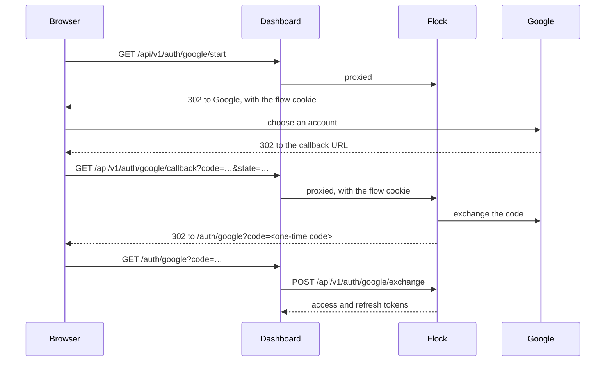

# Accounts and authentication

Look up organization identity, sessions and keys here. For account setup, see [Join an organization](accounts#join-an-organization) or [Create the first account](deploy#create-the-first-account). See [Permissions](permissions) for the authorization matrix.


## API examples

The examples use the organization ID `flock`. Replace the example host with your server and [sign in to the CLI](../cli/sign-in) first:

```bash
export FLOCK=https://flock-api.cerulean.works
TOKEN=$(uv run flock token)
```

Use an account with the permissions required by each operation. The bearer credential is a CLI token or browser access token, never a wandb key.

## Organizations

An organization is a wandb entity. `wandb.init(entity="flock")` logs into the organization `flock`, and every project belongs to one organization. A user can belong to any number of organizations, with a role in each.

An organization has two names:
- **Its ID** (`name` in the API) is the entity. It appears in URLs, in API paths and in `wandb.init(entity=...)`. It's set when the organization is created and never changes, so scripts and links keep working.
- **Its display name** (`display_name`) is what the dashboard shows, such as `Flock Research`. It's free text, and admins can change it at any time.

Only super admins create organizations. A super admin becomes an admin of each organization they create:

```bash
curl -s --json '{"name": "vision", "display_name": "Vision Lab"}' -H "Authorization: Bearer $TOKEN" $FLOCK/api/v1/orgs
```

Without `display_name`, the organization is shown by its ID. The dashboard suggests an ID from the display name you type, such as `vision-lab` for `Vision Lab`, and you can edit it before creating the organization.

To people outside it, an organization doesn't exist: every request about it, or about anything in it, answers 404.

An admin changes the display name with `PATCH /api/v1/orgs/{org}`, even while runs are active, since clients address the organization by its ID. The ID itself can't be changed. Deleting an organization deletes all its projects and runs, permanently.


## Roles

| Role | Can |
|---|---|
| member | Read everything in the organization, create projects, log runs, and edit, move or delete the runs they logged. |
| org admin | Everything a member can, plus invite people, change roles, remove members, change the organization's display name or delete it, update or delete projects, and change any run. |
| super admin | Everything an org admin can, in every organization, whether or not they're a member. Also create organizations and manage user accounts. |

Roles are looked up on every request, so a change applies at once. [Permissions](permissions) has the full matrix.

Two rules keep the server manageable:
- **An organization keeps its last admin.** Demoting or removing its last admin answers 409.
- **The server always keeps a super admin.** Demoting or deleting the last one answers 409.


## The first account

Until an account exists, Flock refuses authenticated requests. The first password or Google sign-up becomes a super admin and an admin of existing organizations. API sign-up creates no organization automatically. Later open sign-ups are refused with 403; accounts join by invitation.

The bundled dashboard handles account creation followed by organization creation. A super admin signing in while no organization exists is returned to that second step. See [Create the first account](deploy#create-the-first-account).

Invitation links are single-use and valid for `FLOCK_INVITE_TTL` (seven days by default). They belong to the invited email. Flock sends no email, and possession of the invitation link is the proof used for a new account. See [Invite members](accounts#invite-and-manage-members) and the [invitation API](api/orgs#invitations).

## Password resets

Flock sends no password-reset email. An administrator creates a single-use link valid for `FLOCK_RESET_TTL` (24 hours by default).

| Action | Authority and effect |
|---|---|
| Create a reset link | Super admins can reset any user. An organization admin can reset a member of an organization they administer, unless that member is a super admin. |
| Redeem a reset | Ends the user's sessions and signs them in again. |
| Change your own password | Ends other sessions while retaining the current session. Requires the current password if one exists. |
| Set a password on a Google-created account | No current password is required because the account has none. |

An organization admin who resets a member's password can sign in as that member, including access to the member's other organizations. Treat that role accordingly. Passwords are 8 to 256 characters. Emails are lowercased and checked for their shape.

See [Manage members](accounts#invite-and-manage-members) for the admin workflow and [Authentication API](api/auth#password-resets) for reset endpoints.

## Sessions

Signing in with `POST /api/v1/auth/login` returns two tokens:
- **An access token**, a JWT valid for 15 minutes (`FLOCK_ACCESS_TOKEN_TTL`). Send it as `Authorization: Bearer <access_token>`.
- **A refresh token**, valid for 30 days (`FLOCK_REFRESH_TOKEN_TTL`). Exchange it for new tokens with `POST /api/v1/auth/refresh` before the access token expires. Each refresh token works once, and every refresh extends the session by another 30 days.

These end a session at once, not when its access token expires:
- signing out with `POST /api/v1/auth/logout`
- changing the password (except the session that changed it)
- a password reset
- deleting the account

Passwords are 8 to 256 characters. Emails are stored in lowercase, and only checked for their shape.


## Signing in from the command line

`flock login` signs a machine in without a password. It prints a code, which the user enters on the dashboard's `/device` page while signed in there. The page shows the machine's hostname, platform and IP address, so the user can check the request is theirs before selecting **Authorize**. The machine then holds a CLI token. The [`flock` command's docs](../cli/sign-in) describe the client side.

A CLI token is a session, like a browser's:
- It never rotates, so any number of processes on the machine can use it at once.
- It lasts until it goes 90 days without use (`FLOCK_CLI_SESSION_TTL`). Each use extends it.
- It ends like other sessions: with `flock logout`, a password change, a password reset or deleting the account. The account page lists each machine under **Command line sign-ins**, where it can be revoked.

Only a browser session can approve a sign-in. A CLI token can't, so a leaked one can't sign in new machines. [Device sign-in](api/auth#device) lists the endpoints.


## wandb keys

The `wandb` SDK uses a wandb key. Each user creates their own, on the account page's **Keys** section, with `flock login` (which offers to log the SDK in), or through the API with an access token or CLI token:

```bash
curl -s --json '{"name": "laptop"}' -H "Authorization: Bearer $TOKEN" $FLOCK/api/v1/me/wandb-keys
```

- A key acts as its user, with all of their roles, but only for experiment tracking: Flock takes it on the wandb protocol, and nowhere else. Scripts and CI that call Flock's REST API use a CLI token instead (`flock token`).
- Keys start with `flock-wandb-`. Keys made before that look like `flock-` and 48 hexadecimal characters, and work the same.
- Flock shows the key once, when it's created. Listings with `GET /api/v1/me/wandb-keys` show only its first 12 characters (`prefix`) and its `name`.
- Keys don't expire, and they keep working after a password change. To revoke one, delete it by its `id`: `DELETE /api/v1/me/wandb-keys/3`.

[Credentials](api/index#credentials) lists which credential does what.

When the server has [S3 storage](s3-behavior), the account page also lists your **S3 keys**, and makes long-lived ones for tools that can't renew a key themselves.


## Avatars

Users and organizations can have an avatar image, which Flock stores and serves. Responses that show a user or an organization include its `avatar_url`.

**Gravatar.** When an account is created, Flock looks up the email's [Gravatar](https://gravatar.com) in the background. If there is one, it becomes the account's avatar. Accounts created before then, or whose owner sets up a Gravatar later, fetch it on request:

```bash
curl -s -X POST -H "Authorization: Bearer $TOKEN" $FLOCK/api/v1/me/avatar/gravatar
```

Looking up a Gravatar sends gravatar.com the SHA-256 hash of the email. To turn the lookup off, set [`FLOCK_GRAVATAR`](configuration) to `false`.

**Uploads.** Users upload their own avatar, and org admins their organization's. The body is the image file, of at most 1 MiB:

```bash
curl -s -X PUT --data-binary @me.png -H "Authorization: Bearer $TOKEN" $FLOCK/api/v1/me/avatar
curl -s -X PUT --data-binary @flock.png -H "Authorization: Bearer $TOKEN" $FLOCK/api/v1/orgs/flock/avatar
```

**Showing them.** An `avatar_url` loads without credentials, so a page can use it as an `` source. It's a path on Flock: a dashboard served from another address either forwards `/api/v1/avatars/*` to Flock, or puts Flock's address in front. The URL is the image's SHA-256, so it can't be guessed. It changes whenever the image does, which lets browsers cache each one for good. [Avatars](api/auth#avatars) lists the accepted formats.


## Managing user accounts

Super admins manage every account:
- `GET /api/v1/users` lists them.
- `PATCH /api/v1/users/{id}` with `{"is_superadmin": true}` makes a user a super admin, and `false` stops them being one.
- `DELETE /api/v1/users/{id}` deletes an account. Its runs stay, without an owner, so only admins can change them afterwards. Deleting the last admin of an organization leaves it without an admin, until a super admin promotes another member.

Other users can't delete accounts, including their own: they ask a super admin.

## Google sign-in

For configuration steps, see [Enable Google sign-in](deploy#enable-google-sign-in).

### How the flow works



1. **Start.** `GET /api/v1/auth/google/start` creates a state, a nonce and a PKCE verifier. It keeps them in a cookie named `flock_google_signin`, signed and valid for 10 minutes, and redirects the browser to Google with the scopes `openid email profile`.
2. **Callback.** Google sends the browser back to the callback URL. Flock checks the state against the cookie, exchanges the code with Google, and checks the ID token's issuer, audience, expiry, nonce and verified email.
3. **Exchange.** Flock redirects the browser to the dashboard's `/auth/google` page with a one-time code. The dashboard posts it to `/api/v1/auth/google/exchange` within 60 seconds, and gets the same tokens as a password sign-in.

Browsers send a cookie only to the host that set it, so the browser must reach the start and the callback through the same host. That's why the dashboard proxies both. The cookie is also limited to the path `/api/v1/auth/google`.


### Which account a Google sign-in uses

Flock looks for the account in this order:
1. The account already linked to this Google account. Google identifies the account by its own user id, so this works even after the Google email changes.
2. An account with the same email address. Google has verified the address, so Flock links the two.
3. The invitation passed to the start as `?invite=<token>`, if its email matches. Flock creates the account as a member of the invitation's organization.
4. If Flock has no accounts at all, this is the [first account](#the-first-account), and it becomes the super admin. Flock creates no organization for it: the dashboard asks for the first organization's display name and ID next.

Otherwise the sign-in is refused with `forbidden`: the person needs an invitation. An email address can be linked to only one Google account.

Accounts created through Google have no password. Their owners can add one with `POST /api/v1/me/password`, without `current`.

### Failure reasons

`GET /api/v1/auth/config` reports whether Google sign-in is on:

```bash
curl --fail https://flock-api.cerulean.works/api/v1/auth/config
```

```json
{"signup_open":false,"google":true}
```

Then sign in from your dashboard. When a sign-in fails, Flock redirects the browser to the dashboard's login page with a reason, `<FLOCK_WEB_URL>/login?error=<reason>&message=<text>`:

| `error` | Cause |
|---|---|
| `google` | Google reported an error (for example, the user cancelled), the code exchange failed, or the ID token didn't verify. Flock logs failed exchanges as a warning, `Google sign-in: code exchange failed`. |
| `expired` | The flow cookie is missing or older than 10 minutes. This also happens when the start and the callback reach Flock through different hosts. |
| `state` | The `state` from Google doesn't match the flow cookie. |
| `unverified` | The Google account's email address isn't verified. |
| `invite` | The invitation passed to the start is invalid, expired or already used. |
| `forbidden` | There is no account for this email and no invitation, the invitation is for another email, or the email is already linked to another Google account. |

If Google shows a `redirect_uri_mismatch` error instead of its account chooser, the callback URL Flock sends doesn't match the one you registered in step 2.
