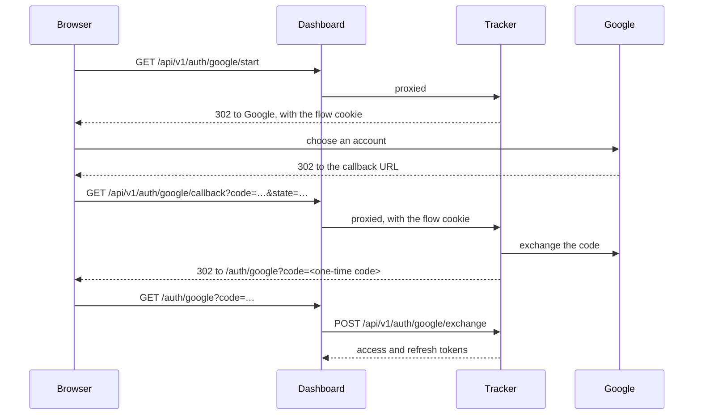

# Setting up Sign in with Google

This page shows how to let people sign in to the tracker with their Google accounts. The tracker runs the OAuth authorization-code flow itself, with PKCE. Your dashboard only sends the browser to the tracker, and exchanges a one-time code for tokens at the end.

You need:
- A Google Cloud project where you can create OAuth clients.
- A dashboard that proxies the paths `/api/v1/auth/google/*` to the tracker, as flock-ui does, or a tracker that browsers can reach directly.

## How the flow works



1. **Start.** `GET /api/v1/auth/google/start` creates a state, a nonce and a PKCE verifier. It keeps them in a cookie named `flock_google_signin`, signed and valid for 10 minutes, and redirects the browser to Google with the scopes `openid email profile`.
2. **Callback.** Google sends the browser back to the callback URL. The tracker checks the state against the cookie, exchanges the code with Google, and checks the ID token's issuer, audience, expiry, nonce and verified email.
3. **Exchange.** The tracker redirects the browser to the dashboard's `/auth/google` page with a one-time code. The dashboard posts it to `/api/v1/auth/google/exchange` within 60 seconds, and gets the same tokens as a password sign-in.

Browsers send a cookie only to the host that set it, so the browser must reach the start and the callback through the same host. That's why the dashboard proxies both. The cookie is also limited to the path `/api/v1/auth/google`.

## 1. Choose the callback URL

The callback URL is where Google sends the browser back. By default it is:

```text
<TRACKER_APP_URL>/api/v1/auth/google/callback
```

This goes through the dashboard, so the tracker itself doesn't need to be reachable from browsers. Without `TRACKER_APP_URL`, the tracker uses `TRACKER_PUBLIC_URL`, and without that, the address the request reached.

If browsers reach the tracker directly, or your dashboard proxies another path, set `TRACKER_GOOGLE_REDIRECT_URL` to the full callback URL, for example `https://tracker.example.com/api/v1/auth/google/callback`.

## 2. Register the OAuth client

In the Google Cloud console, create an OAuth client ID of type **Web application**. Add the callback URL from step 1 under **Authorized redirect URIs**. Google compares it character for character, so match the scheme, host, port and path exactly.

Copy the client ID and the client secret.

## 3. Configure the tracker

Set both values, and the dashboard's address. With Docker Compose, put them in the `.env` file next to `compose.yaml`:

```bash
TRACKER_APP_URL=https://flock.example.com
TRACKER_GOOGLE_CLIENT_ID=1234567890-abc123.apps.googleusercontent.com
TRACKER_GOOGLE_CLIENT_SECRET=GOCSPX-your-client-secret
```

Then recreate the tracker so it reads them:

```bash
docker compose up -d
```

Google sign-in is on only when both the client ID and the secret are set. Otherwise, the start and callback endpoints answer 404.

## 4. Proxy the Google paths

If you use flock-ui, it already proxies `/api/v1/auth/google/*`. For your own dashboard, forward those paths to the tracker unchanged, with their cookies and redirect responses. With nginx in front of the dashboard, for example:

```nginx
location /api/v1/auth/google/ {
    proxy_pass http://tracker:8080;
}
```

When the callback URL uses `https`, the tracker marks the flow cookie `Secure`, so the browser only sends it back over HTTPS.

## 5. Check that it works

`GET /api/v1/auth/config` reports whether Google sign-in is on:

```bash
curl -s $TRACKER/api/v1/auth/config
```

```json
{"signup_open":false,"google":true}
```

Then sign in from your dashboard. When a sign-in fails, the tracker redirects the browser to the dashboard's login page with a reason, `<TRACKER_APP_URL>/login?error=<reason>&message=<text>`:

| `error` | Cause |
|---|---|
| `google` | Google reported an error (for example, the user cancelled), the code exchange failed, or the ID token didn't verify. The tracker logs failed exchanges as a warning, `Google sign-in: code exchange failed`. |
| `expired` | The flow cookie is missing or older than 10 minutes. This also happens when the start and the callback reach the tracker through different hosts. |
| `state` | The `state` from Google doesn't match the flow cookie. |
| `unverified` | The Google account's email address isn't verified. |
| `invite` | The invitation passed to the start is invalid, expired or already used. |
| `forbidden` | There is no account for this email and no invitation, the invitation is for another email, or the email is already linked to another Google account. |

If Google shows a `redirect_uri_mismatch` error instead of its account chooser, the callback URL the tracker sends doesn't match the one you registered in step 2.

## Which account a Google sign-in uses

The tracker looks for the account in this order:
1. The account already linked to this Google account. Google identifies the account by its own user id, so this works even after the Google email changes.
2. An account with the same email address. Google has verified the address, so the tracker links the two.
3. The invitation passed to the start as `?invite=<token>`, if its email matches. The tracker creates the account as a member of the invitation's organization.
4. If the tracker has no accounts at all, this is the [first account](accounts#the-first-account), and it becomes the super admin.

Otherwise the sign-in is refused with `forbidden`: the person needs an invitation. An email address can be linked to only one Google account.

Accounts created through Google have no password. Their owners can add one with `POST /api/v1/me/password`, without `current`.
