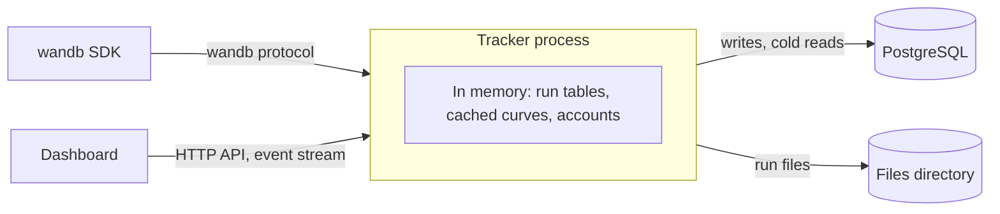

# How it works

The tracker's design follows from one requirement: dashboards must get curves and filtered run tables back in a few milliseconds, even across 10,000 runs with 1,500 columns each. This page explains the choices that make that possible, and what they cost.

## One process, with PostgreSQL for durability

The tracker answers reads from its own memory. It holds every project's run table, the curves of active and recently read runs, and the accounts. PostgreSQL is the source of truth: every write is committed there before the tracker acknowledges it, and the tracker loads its memory from it at startup.

A query planner would take longer than the latency budget allows. A filter over 10,000 runs is instead a few vectorized passes over arrays of 10,000 elements, which take microseconds per clause.

This costs three things:
- **One tracker per database.** Two processes would hold diverging copies, so the tracker takes a PostgreSQL advisory lock, and a second one refuses to start.
- **Startup time** grows with the number of runs: a few seconds for 10,000 runs with 1,500 columns.
- **Memory** grows with runs × columns.

After loading, the tracker moves its long-lived objects out of the reach of Python's cyclic garbage collector, so full collections don't pause requests.

## The run table

Each project keeps a column table of its runs. The columns are the run attributes, such as `state` and `tags`, plus the flattened config and summary keys, such as `config.model.layers` and `summary.val_loss.min`. Each column holds:
- an array of 64-bit floats for numeric values
- an array of objects for other values, such as strings and lists
- a mask saying which runs have a value

A filter compiles to numpy operations over these arrays, so it never touches the database. A column disappears when no run has a value for it any more, so the column list stays accurate.

Rows stay in creation order, which is why "newest first" is the default sort. Deleting or moving runs rebuilds the affected tables, which takes tens of milliseconds for 10,000 runs with 1,500 columns.

## Curves: hot in memory, cold in compact columns

A run has two series streams: its logged history and its system metrics. Each stream holds one series per metric: an array of line numbers and an array of values. `_step`, `_runtime` and `_timestamp` are series like any other, which is why any metric can be a chart's x-axis.

- **Active runs** are always in memory, and their series grow as lines arrive.
- **When a run stops being active**, each stream is compacted in the background into one binary blob per metric, stored in PostgreSQL. A blob holds the values as 64-bit floats, preceded by 32-bit line numbers unless the metric was logged on every line. Blobs are stored uncompressed and out of line, since floats barely compress, so reading one needs no decompression.
- **Recently read runs** stay in a cache, bounded by a total number of points (`TRACKER_HISTORY_CACHE_POINTS`). The least recently read runs leave it first.
- **Cold curves** load in one batched query per request, whatever the number of runs. Concurrent requests for the same run share one load.

## The write path

The SDK streams each run's data in `file_stream` requests. Each one carries new history lines, system samples, console lines and the latest summary, addressed by line number. The tracker applies a whole request in a single SQL statement, so it costs one round trip and is atomic. It acknowledges the request only after it commits.

Lines are keyed by run and line number, and written with upserts. The SDK resends chunks it couldn't confirm, and a resent chunk changes nothing.

Raw wandb JSON (config, summary, and history and event lines) is stored as `text`, not `jsonb`, because wandb writes `NaN` and `Infinity` literals, which `jsonb` rejects.

## Live updates

Dashboards subscribe to a project's runs with Server-Sent Events. When a write arrives for a run that a dashboard watches, the tracker pushes the new points to that dashboard. Writes to runs nobody watches cost nothing extra.

A dashboard renders from a snapshot first, which records each run's line count, then subscribes with those counts. The tracker subscribes the dashboard before it computes the replay, so the replay and the live events overlap rather than leave a gap. Each subscriber has a bounded queue. One that falls behind is disconnected rather than buffered without limit, and it reconnects with its latest counts.

## Authentication cost

Users, memberships, API key hashes and sessions are loaded into memory, so authenticating a request costs a SHA-256 of the API key, or an HMAC check of the access token, plus a dictionary lookup. It never waits for the database.

Roles aren't put into tokens. They're looked up on every request, so a role change applies at once. Each access token names its session, and a session that ended stops its tokens at once. Passwords are hashed with argon2id in a worker thread, so the tens of milliseconds it takes don't hold up other requests.

## Deletes and moves

Deletes are hard: the rows go, and nothing is kept to restore. A delete takes the project's lock, then the runs' locks, always in the same order, so concurrent changes never deadlock. Writes from a run's client hold that run's lock, so a run is never deleted halfway through a write.

A live client is never told its run was deleted. It keeps sending, and when it finishes, it even tries to create the run again. The tracker remembers runs that were force-deleted while active, and drops their clients' writes until they have been quiet for `TRACKER_CRASH_TIMEOUT`. That's why an active run can't be moved, and its project can't be renamed: its client would keep writing to the old path.

## Performance

These numbers come from the tracker's latency test suite, measured end to end on an Apple Silicon laptop with PostgreSQL in Docker. They include HTTP over a keep-alive connection and decoding the response on the client.

| Scenario | p50 | Budget |
|---|---|---|
| `loss` curves of the newest 50 runs, 500 points each | ~2 ms | 10 to 20 ms |
| The same, cold (all loaded from PostgreSQL) | ~4 ms | 10 to 20 ms |
| `loss`, `val_loss` and `lr` of the newest 50 runs | ~4.5 ms | 10 to 20 ms |
| Curves of the active runs while they stream history | ~1 ms | 10 to 20 ms |
| A 6-clause filter and a sort over 10,000 runs × 1,500 columns | ~2.5 ms | 20 to 50 ms |
| `$or`, a regex and a string `$in` over 10,000 runs × 1,500 columns | ~3 ms | 20 to 50 ms |
| Deleting about 950 of those 10,000 runs | ~90 ms | 200 ms |
| Moving 500 of those runs to another project | ~50 ms | 200 ms |
